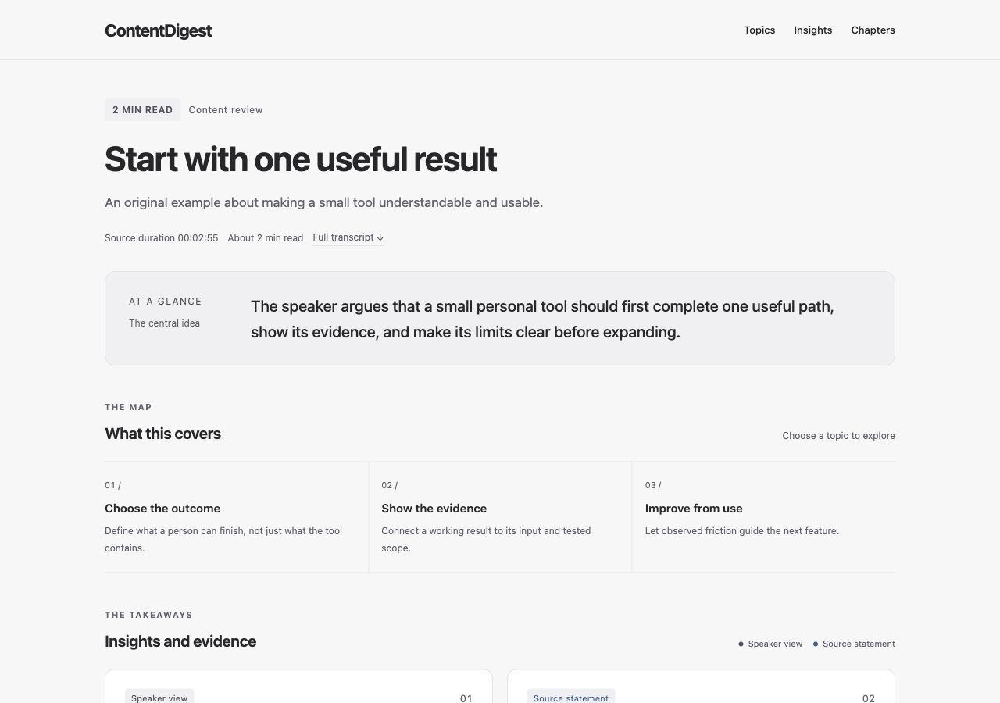

# ContentDigest

Turn podcasts and videos into timestamped transcripts and interactive reading pages.

An Agent Skill that downloads audio from a public Apple Podcasts episode or YouTube video, transcribes it locally with whisper.cpp, and helps your coding agent build a source-linked digest after reading the full transcript. Existing TXT and SRT transcripts can skip the audio step.

## See the result



[Open the sample HTML file](examples/sample/ContentDigest.html) · [Read the input and reproduction steps](examples/README.md)

Download the repository and open the HTML file in a browser; GitHub's file view shows its source. The sample is generated from an original, authored SRT fixture with illustrative timestamps. It demonstrates the working reader and text-import path, not a real podcast or a live transcription test.

## Why use it?

A short summary can hide the evidence and qualifications behind a claim. ContentDigest keeps the main reading path short while connecting each insight to its example, limits, supporting detail, and source excerpt.

## What you get

- A topic map and a small set of insights with their evidence and qualifications.
- Expandable supporting detail and chapter navigation.
- Short quotations checked against the supplied transcript.
- Timestamp buttons that show source excerpts; YouTube links can seek to the corresponding time.
- A full transcript, SRT when timestamps exist, and editable JSON alongside the reading page.

The target is roughly a three-minute main read when the source warrants it. Short sources produce shorter pages. The page uses local assets and no external fonts, analytics, or automatic network requests.

## Quick start

### Try the reader without a model

Requires Python 3.12+; the importer and renderer use only the standard library.

```bash
git clone https://github.com/JessicaLiu996/content-digest.git
cd content-digest
python3 skills/content-digest/scripts/build_reader.py examples/sample/digest.json
```

Open `examples/sample/ContentDigest.html` in a browser. This rebuilds the included example; it does not generate a new summary from an arbitrary transcript.

### Use the Skill with your agent

Install with the [Skills CLI](https://github.com/vercel-labs/skills), using its supported Node.js version:

```bash
npx skills add JessicaLiu996/content-digest --skill content-digest
```

Choose your agent. The installable package is [`skills/content-digest/`](skills/content-digest/); manual installation can copy that whole directory into your configured skill directory. Reload skills or start a new session as required by the client.

For existing text:

```text
Use $content-digest with my supplied transcript.
Read the whole text, then create an English reading page with evidence,
qualifications, and a full transcript attachment. Do not invent timestamps.
```

For an episode, first complete the [local transcription setup](skills/content-digest/references/runtime.md):

```text
Use $content-digest to process this episode URL: [paste one episode URL].
Use the configured local whisper.cpp model, read the entire transcript,
and create an English digest. Keep the full transcript in its original language.
```

## Requirements and limits

| Route | Requirements |
| --- | --- |
| Rebuild included reader | Python 3.12+, a browser with JavaScript |
| Import TXT/SRT | Python 3.12+; an agent reads and summarizes the imported text |
| Transcribe a public link | macOS or Linux, Python 3.12+, Node.js 22+, ffmpeg/ffprobe, whisper-cli, Python dependencies, a separately downloaded GGML model |

The transcription script uses Unix file locking; native Windows transcription is not supported by this package. Linux is an intended target but has not been tested for this release. The clean-copy importer and reader were tested on macOS; downloading and full audio transcription were not re-run for this publication draft.

Speech recognition is local. Downloads need network access, and summarization uses your chosen agent, which may process transcript text through its service. The end-to-end workflow is not fully offline. Models and environments are not included in the repository.

Private, deleted, region-restricted, or platform-blocked sources may fail. Browser login state is used only when explicitly authorized. The skill does not bypass access restrictions, perform video OCR, identify speakers, or publish the output automatically. Transcripts may contain recognition errors, and source statements are not independently fact-checked by default.

## Documentation

- [Runtime and setup](skills/content-digest/references/runtime.md)
- [Reading-page content rules](skills/content-digest/references/output.md)
- [Digest JSON format](skills/content-digest/references/page-schema.md)
- [Reproduce the example](examples/README.md)

Created by [Jessica](https://github.com/JessicaLiu996). Uses [yt-dlp](https://github.com/yt-dlp/yt-dlp), [whisper.cpp](https://github.com/ggml-org/whisper.cpp), and [OpenCC](https://github.com/yichen0831/opencc-python); these dependencies and downloaded models retain their own licenses.

## Local checks

```bash
python3 -m unittest discover -s tests -v
```

These offline checks exercise import, rendering, source integrity, and output preservation. They do not run media downloading or speech recognition.

## License

Skill instructions and source code are available under the [MIT License](LICENSE).
External tools and downloaded models retain their own licenses.
